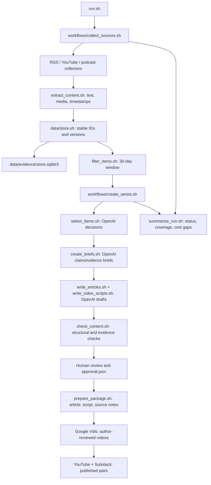

# Problem Set 4 Student Submission

This is the entry point for the project and its published series. The unchanged course instructions and required contracts are in [README.md](README.md) and [ARCHITECTURE.md](ARCHITECTURE.md).

**Student:** Rey Bao
**GitHub repository:** https://github.com/reybao/ps04-ai-real-estate-loop

## Topic and Audience

- **Publication name:** The AI Real Estate Loop
- **Topic:** AI for Real Estate and Real Estate for AI, focused on U.S. commercial real estate, PropTech, AI data centers, and their land and power infrastructure.
- **Audience and assumed knowledge:** Real estate, architecture, and engineering students and early-career professionals interested in AI and the built environment. Readers understand basic industry vocabulary but do not need data-center engineering or machine-learning expertise.
- **Central question:** What developments in the preceding 30 days materially changed how AI is used in real estate or how land, power, construction capacity, financing, and regulation shape AI infrastructure?
- **Scope and exclusions:** Includes evidence-based CRE AI adoption, PropTech, powered land, data-center development, utilities, permitting, delivery, finance, and community constraints. Excludes general AI news without a built-environment connection, stock recommendations, undated or stale evidence, and unsupported promotional claims.
- **Reason for readers to return:** Each edition separates verifiable changes from repeated announcements and connects AI adoption in buildings with the physical infrastructure required to run AI.

## Published Series

The three articles were published on Rey's Substack as web-only posts (without email delivery), and the companion videos were published on Rey's YouTube channel as unlisted videos. Anyone with a video link can view it. Course staff should test all six links without relying on the author's signed-in accounts.

| Piece | Title | Substack article | YouTube video |
| --- | --- | --- | --- |
| 1 | From AI Pilots to Property Operations: The Hard Part Is Making It Work | [Substack](https://rey1241762.substack.com/p/from-ai-pilots-to-property-operations) | [YouTube (unlisted)](https://youtu.be/VRRoPB0pCTU) |
| 2 | A Data-Center Site Is Not a Delivered AI Campus | [Substack](https://rey1241762.substack.com/p/a-data-center-site-is-not-a-delivered) | [YouTube (unlisted)](https://youtu.be/h0fmNizbPZE) |
| 3 | AI Infrastructure’s Bottlenecks Are Not Just About Power | [Substack](https://rey1241762.substack.com/p/ai-infrastructures-bottlenecks-are) | [YouTube (unlisted)](https://youtu.be/d5w5KWDxfYk) |

**Separate technical demonstration video:** [YouTube (unlisted)](https://www.youtube.com/watch?v=FLWnEudZL5I). This narrated systems walkthrough is distinct from the three audience-facing videos above.

### Video production handoff

Three approximately four-minute videos were produced from the approved October 10 package. Each uses the author's authorized Google Vids avatar in the opening and closing, Iro narration in the body, and content-specific conceptual motion graphics alongside the source-based visual narrative. Generated illustrative footage is not actual footage of a named site or evidence of a reported outcome. Editable Google Vids drafts and intermediate Drive MP4 exports remain private to the author; the public submission uses the final YouTube links above rather than exposing private editing links.

The three Drive MP4 previews loaded and played in the author's account on October 10. The audience-facing videos were subsequently uploaded to YouTube; their published URLs, rather than these private production files, are the submission links. In a signed-out browser on October 10, all three Substack articles opened with companion-video links, and all three unlisted YouTube watch pages opened. The displayed durations were 3:53, 3:52, and 4:08; each YouTube description included the paired article, source references, and AI-avatar/voice and conceptual-visual disclosures. This access check did not independently audit the full final playback or caption quality, so the author should still check those before submission.

## Setup and Execution

The implementation uses Bash 3.2+, Python 3, SQLite, Git, `yt-dlp`, `ffmpeg`, and local Python Whisper `small.en` for newly extracted YouTube media. AI editorial and writing stages use the OpenAI Responses API with Structured Outputs. The default editorial model is `gpt-6-luna` at low reasoning effort; both are configurable in the ignored `.env.local`. The only secret environment variable is `OPENAI_API_KEY`; local Whisper does not use it. No secret value is committed. The October 9 first run predates local media capture and its YouTube item records retain captions only; a later live run must document media retention or an explicit download failure. See [RUN_GUIDE.md](RUN_GUIDE.md) for setup and handoff details.

Local integration tests succeeded with Python Whisper `small.en` for a synthetic video, a simulated audio-only fallback, and a simulated `android_vr` video fallback. Initial live media download tests for two collected YouTube items returned HTTP 403. Later 10 KB `android_vr` format-18 samples succeeded for all three cited YouTube videos. A separate end-to-end check of the collected 8:36 water/electricity video retained an 18 MB MP4 and generated 137 timestamped segments with local Whisper; the default video path succeeded in that check. This check is stored under `runs/replays/youtube-media-check-20261009/` and does not rewrite the first run. The first run still has 10 caption-only YouTube item records, including three cited items. The revised review and summary flag this gap; a caption transcript or 10 KB test fragment is not being represented as complete downloaded media.

The required entry commands are:

```bash
bash run.sh
bash run.sh --package runs/RUN_ID
```

The run used for the published package is `runs/20261010T152011Z-e9d7cb`. For a clean setup, copy `.env.example` to the ignored `.env.local`, enter a personal API key there, and review `config/project.json`, `config/sources.json`, `config/editorial_policy.md`, and the four prompts in `prompts/`. The exact tool versions, installation commands, and stage-replay commands are in [RUN_GUIDE.md](RUN_GUIDE.md). Never commit `.env.local` or a live key.

## Architecture and Manual Handoffs



The three collectors emit candidate JSONL records. Extraction retains article text or timestamped media transcripts; `data/store.sh` is the only component that owns the persistent SQLite evidence index. Filtering emits eligible and excluded records. The editorial and writing components use the saved project settings, policy, and prompts to call the OpenAI API; each stage saves JSONL output and logs under its run directory. `review/check_content.sh` checks references and structure, but does not substitute for human factual judgment. `reporting/summarize_run.sh` records counts, incomplete stages, elapsed time, models/tools, and unknown costs. The local test suite (`python3 -m unittest discover -s tests -v`) passed 19 tests on October 10.

The manual boundary begins at [the October 10 review](runs/20261010T152011Z-e9d7cb/review.json) and [approval](runs/20261010T152011Z-e9d7cb/approval.json). The packager then emits [articles, scripts, source notes, and a manifest](runs/20261010T152011Z-e9d7cb/package/manifest.json). The author used those scripts and evidence notes to produce three Google Vids projects, checked the exports, uploaded the final videos to YouTube as unlisted, and published the corresponding free Substack articles. The [publication-links record](runs/20261010T152011Z-e9d7cb/package/publication_links.json) connects the final six URLs to the approved package. Video rendering and platform publishing are not claimed to be automated by `run.sh`.

## Evidence and Runs

| Run | Actual date | Inspectable records | Recorded elapsed time | API cost |
| --- | --- | --- | --- | --- |
| First live run | October 9, 2026 | [Run metadata](runs/20261009T165149Z-afdf19/run.json), [summary](runs/20261009T165149Z-afdf19/summary.json), [decisions](runs/20261009T165149Z-afdf19/decisions.jsonl), [briefs](runs/20261009T165149Z-afdf19/briefs.jsonl), [review](runs/20261009T165149Z-afdf19/review.json), [logs](runs/20261009T165149Z-afdf19/logs/) | 11,302 seconds (includes later stage work) | Unknown; the pipeline recorded no reliable billed-token estimate |
| Second live run | October 10, 2026 | [Run metadata](runs/20261010T152011Z-e9d7cb/run.json), [summary](runs/20261010T152011Z-e9d7cb/summary.json), [decisions](runs/20261010T152011Z-e9d7cb/decisions.jsonl), [briefs](runs/20261010T152011Z-e9d7cb/briefs.jsonl), [review](runs/20261010T152011Z-e9d7cb/review.json), [approval](runs/20261010T152011Z-e9d7cb/approval.json), [logs](runs/20261010T152011Z-e9d7cb/logs/) | 11,834 seconds (includes later stage work) | Unknown; `$0.00 known` in the JSON is not a claim that API use was free |

The second run discovered 37 candidate items and retained 36; its [change record](runs/20261010T152011Z-e9d7cb/changes.jsonl) marks 9 new, 16 changed, and 11 unchanged versions. `unchanged` versions were reused rather than inserted as duplicate evidence versions; the [store-upsert receipt](runs/20261010T152011Z-e9d7cb/logs/store-upsert-b3dac6f25251.json) and the persistent `data/evidence/store.sqlite3` index document that behavior. A changed *extraction version* does not by itself establish a new real-world development. The second run had 38 eligible items spanning 27 feed, 8 YouTube, and 3 podcast items from 11 publisher IDs; selection recorded 13 accepts, 22 rejects, and 3 deferrals. Its [five exclusions](runs/20261010T152011Z-e9d7cb/exclusions.jsonl) were all `outside_window`. See [the first-run exclusions](runs/20261009T165149Z-afdf19/exclusions.jsonl) for the same date check on October 9.

Both live runs logged incomplete collection rather than silently omitting failures. On October 10, [the extraction error](runs/20261010T152011Z-e9d7cb/extraction_errors.json) concerns a YouTube live event that had not started; it was not used as publication evidence. The extractor retained all available other material, and the [October 10 media metadata](runs/20261010T152011Z-e9d7cb/extraction_metadata.json) reports no media gaps among successfully extracted items. The October 9 run predated local YouTube media capture and retains caption-only YouTube evidence; that historical gap is disclosed rather than retroactively rewritten. Large raw HTML, audio/video downloads, full third-party article text/transcripts, and the local Whisper model are omitted from the public repository. A small [RSS/YouTube/podcast evidence sample](EVIDENCE_SAMPLE.md) preserves exact short passages and timestamps. The source URL, version ID, relative local asset path, publication date, and evidence locator are preserved in the run's `items.jsonl`/`briefs.jsonl`. To retrieve omitted material, rerun the relevant collector/extractor against each recorded source URL; `yt-dlp` and `ffmpeg` handle media as described in [RUN_GUIDE.md](RUN_GUIDE.md). Availability and copyright permissions may differ later, so a later download is not represented as the originally retained version.

The [policy-revision replay](runs/replays/20261009-policy-v2/) reused the first run's 29 eligible items and changed only the policy snapshot for a same-day selection comparison. It is labeled a replay, **not** the second live run. An isolated [YouTube media check](runs/replays/youtube-media-check-20261009/) tested a complete download and local transcription; it likewise did not rewrite the first run.

### One published claim traced to evidence

Article [02](https://rey1241762.substack.com/p/a-data-center-site-is-not-a-delivered) calls the RELLIS site's 73 MW and roughly 25 acres a *reported plan*, not delivered capacity. That is claim `02-c1` in the [October 10 brief](runs/20261010T152011Z-e9d7cb/briefs.jsonl), which cites `feed:18968329a0faac4776650ff5`, version `7e69812224285e5c9151b7057332c13c33f9f40153548b3a01c074600bbb6c1f`. The [selection decision](runs/20261010T152011Z-e9d7cb/decisions.jsonl) marked the item `accept` specifically as an attributed development plan, not proof of delivered power. The exact retained [Data Center Knowledge](https://www.datacenterknowledge.com/ai-data-centers/thisway-global-to-convert-bankrupt-rellis-site-into-73-mw-ai-hub) passage includes: “TWG plans a phased Research and AI Compute Center (RACC) totaling 73 MW on about 25 acres of TAMUS land.” The same source says deployment is tied to confirmed power and utility approvals; article 02 preserves that limitation.

## Editorial Review

Link to the editorial policy and prompts used. Provide your review of at least three accepted and three rejected or deferred items, comparing the AI's reasons with your own judgment.

Show the policy before and after your revision, the affected stage outputs, and what changed. Record factual corrections, remaining limitations, and the evidence for your final publication approval.

### Historical first-run editorial correction (not approval of that run)

The author requested that first-run piece 01 retain the battery-storage evidence but connect it more clearly to the site-selection argument. The draft article and paired video script were revised to move from PJM's planned projects and expected delivery date, to an attributed storage-cost comparison, and finally to the question of whether power is actually deliverable to a particular parcel. This avoids treating a cheaper storage estimate as proof of site readiness. During source review, the author also agreed to retain the PJM item as `accept` but correct the brief, article, and script from "approved" to "accepted into the expedited interconnection track," after a supplementary cross-check of [PJM's announcement](https://insidelines.pjm.com/pjm-accepts-first-expedited-interconnection-track-projects/). The original media passage remains unchanged in the evidence locator; the PJM page is a human cross-check, not a retained first-run source. This October 9 draft series was **not** the one ultimately published.

### Student review of six first-run selection decisions

| Item | AI decision and rationale | Student judgment |
| --- | --- | --- |
| `feed:013533b5c09c1313d651ed92` — [Utility Dive on Wood Mackenzie's four-hour storage estimate](https://www.utilitydive.com/news/4-hour-storage-cheaper-than-gas-peakers-across-global-markets-woodmac/832489/) | `accept`: a recent cost estimate relevant to possible power options for data centers, but not independent proof of a specific project's economics or power delivery. | **Agree with accept.** I checked the retained source passage and found that the article clearly identifies the estimate's source. It attributes the comparison to Wood Mackenzie via Utility Dive and does not treat the estimate as proof that a particular site has power available. |
| `feed:bd64640bf5f3c4d766531008` — [Utility Dive on PJM's fast-track projects](https://www.utilitydive.com/news/engie-ls-power-pjm-expedited-interconnection-eit/832613/) | `accept`: recent, relevant reporting on about 2.1 GW of planned projects and their expected mid-2029 online date; useful for distinguishing planned capacity from electricity already deliverable to a site. | **Agree with accept, with a wording correction.** I checked the retained media passage and consider Utility Dive a credible specialist trade publication, although it is a secondary source. I also checked [PJM's Oct. 8 announcement](https://insidelines.pjm.com/pjm-accepts-first-expedited-interconnection-track-projects/). PJM says the projects were *accepted into* its expedited interconnection process, not that they are operating or have completed interconnection agreements. I therefore changed the brief, article, and script to use "accepted," while keeping the original media quotation intact for traceability. |
| `feed:18968329a0faac4776650ff5` — [Data Center Knowledge on the proposed RELLIS AI hub](https://www.datacenterknowledge.com/ai-data-centers/thisway-global-to-convert-bankrupt-rellis-site-into-73-mw-ai-hub) | `accept`: a relevant example of proposed redevelopment for AI computing, but the 73 MW capacity, power status, financing, and technical plans are primarily company-reported. | **Agree with accept, with the stated limitation.** I checked that article 02 distinguishes the company's 73 MW plan from delivered power: it says deployment depends on confirmed power availability and applicable utility approvals and explicitly calls 73 MW a plan, not verified operating capacity. The case is useful as a proposed project, not evidence that the campus is built or energized. |
| `feed:f6973c63e50dbf5abafa2203` — [Data Center Knowledge on EMEA expansion](https://www.datacenterknowledge.com/data-center-site-selection/emea-data-center-expansion-faces-a-delivery-test) | `reject`: its grid, construction, and community constraints are relevant, but the reported developments and forecasts concern EMEA rather than the project's U.S. focus. | **Agree with reject as evidence for this U.S.-focused edition.** The article may offer comparative context, but it does not establish a new U.S. development. Rejection here is a scope decision, not a judgment that the article is inherently unreliable. |
| `podcast:223db528eee688b9b40cdb33` — [MCIS off-site construction interview](https://podcasters.spotify.com/pod/show/dcrevolution/episodes/Offsite--On-Mission-Building-Faster-and-Safer-Data-Centers-with-MCIS-e3pcu6u) | `defer`: the interview offers relevant practitioner observations, but the AI said the guest's identity was not established and asked for stronger support for project and delivery claims. | **Agree with defer, but not with the identity reason.** The retained transcript identifies Cheryl Kinghorn as an MCIS executive vice president at the start, so that part of the AI's explanation is wrong. The host also describes the program as a platform for sponsors. I would use the interview, at most, as clearly attributed practitioner perspective until specific projects, schedule effects, and other broader claims can be independently checked. |
| `youtube:m9duvzaGdpw` — [Kite & Key on data-center water use and electricity bills](https://www.youtube.com/watch?v=m9duvzaGdpw) | `defer`: the video addresses a timely concern, but the supplied timestamped transcript does not provide locatable underlying sources for its numerical comparisons and causal claims. | **Agree with defer.** The water-use comparisons, residential-rate figures, and claim that data centers lowered rates require checking against the underlying research and its methods before publication. I would not present the rate claim as established causation on the strength of this video alone. The retained YouTube asset is a caption file, not a downloaded video or audio recording. |

### Editorial policy revision and controlled replay

The first run's original policy remains in `runs/20261009T165149Z-afdf19/config/editorial_policy.md`. I revised `config/editorial_policy.md` in two ways: (1) numerical comparisons and causal claims now require a traceable underlying study, dataset, or primary record with the relevant date, geography, definitions, and method; and (2) a decision based on an excerpt must say a detail is not visible *in that excerpt*, rather than claiming it is absent from the full source. These changes respond to the water-and-electricity video's unsupported quantitative claims and the AI's incorrect assertion that the MCIS guest was unidentified in the complete transcript.

I reran only `editorial/select_items.sh` in `runs/replays/20261009-policy-v2/`, using the same 29 eligible items, run metadata, project/source configuration, and selection prompt as the first run. Only the policy snapshot differed. The original `decisions.jsonl`, briefs, drafts, and run snapshot were not overwritten. This same-day policy replay is **not** the required second live run.

| Decision | Original policy | Revised-policy replay | Editorial interpretation |
| --- | --- | --- | --- |
| Overall counts | 11 accept, 16 reject, 2 defer | 10 accept, 17 reject, 2 defer | Three of 29 decision labels changed; the other 26 labels did not. All 29 reason strings changed in wording, which by itself is not evidence of a substantive policy effect. |
| MCIS construction interview | `defer` | `accept` | The replay limits its use to attributed practitioner perspective and explicitly says it does not prove general delivery benefits. My earlier human decision to defer unsupported project and schedule-effect claims still stands; the replay does not approve those claims for publication. |
| Data Center Frontier project-delivery panel | `accept` | `defer` | The replay says the supplied excerpt does not identify the speaker or project behind an 860-acre, 900-MW Virginia-site description. That specific claim needs attribution and project-status verification before use. |
| CRECo AI/real-estate roundtable | `accept` | `reject` | The replay finds anecdotal observations insufficiently specific or evidenced for the edition's central question. |
| Water/electricity explainer | `defer` | `defer` | The replay makes the missing underlying studies, dates, geography, definitions, and causal support more explicit. |

The first-run briefs cite both YouTube items whose labels became `defer` or `reject`; those drafts were not published. The published series instead came from the October 10 run and its [approved review](runs/20261010T152011Z-e9d7cb/approval.json). A single nondeterministic AI replay shows an observed difference, not proof that policy text alone caused every wording or label change. The October 10 pieces use a new set of three briefs and distinguish source claims from independently verified outcomes.

## Reflection

**Insight.** The three pieces connect a common distinction across software and infrastructure: adoption, announced capacity, or a promising site is not the same as verified operational value. CRE AI pilots need a defined task and a way to check results; data-center plans need power, approvals, construction, and other conditions before capacity is delivered. That synthesis is more useful to the audience than repeating the largest announced numbers.

**Editorial failure and correction.** In the first run, the AI treated an interview guest's identity as missing even though the retained complete transcript named her, and a PJM milestone needed correction from “approved” to “accepted into” an expedited track. Human review checked the full source, corrected the wording, and changed the policy to prohibit claims of absence based only on an excerpt. The first-run drafts were not published. The later published run also retains uncertainty around survey summaries, company-reported project plans, and practitioner claims.

**Architecture tradeoff and next improvement.** The 16 required Bash entry points keep the stages independently callable, while Python helpers handle extraction, SQLite, and structured AI outputs. Local Whisper increases runtime and storage use but retains timestamped YouTube evidence without a transcription API call. Human approval and Google Vids production remain outside `run.sh` because factual framing, visual appropriateness, and authorized avatar/voice use require review. The next improvement would retrieve primary filings, utility records, and underlying research more systematically so that important quantitative claims do not depend on one secondary report or company announcement.
